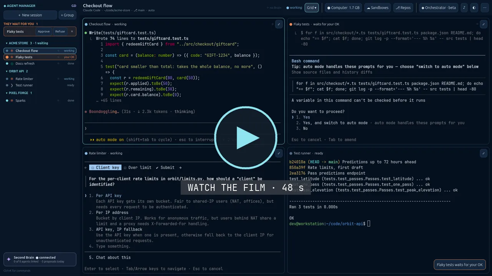
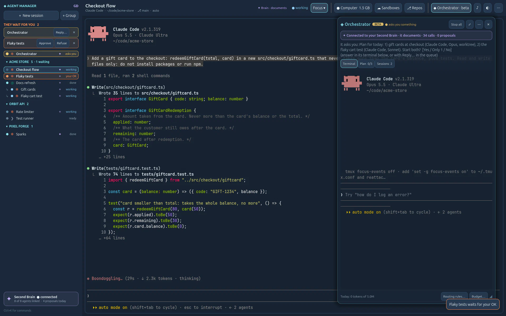
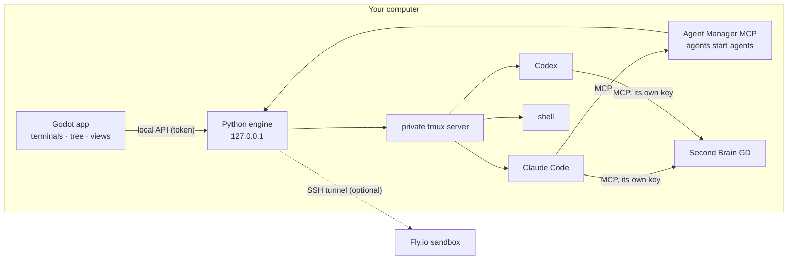

<p align="center">
  
</p>

<h1 align="center">Agent Manager GD</h1>

<p align="center"><b>Your agent lab.</b><br>
Claude Code, Codex and your shells side by side: isolated, observed, in your control.<br>
Every agent. Every environment. One control room.</p>

<p align="center">
  <a href="LICENSE"></a>
  
  
  
  <a href="https://github.com/sonixz/agent-manager-gd/actions/workflows/tests.yml"></a>
</p>

> **This is a lab.** Run it on your own computer; don't put it on the internet unless you know what you're doing
> (TCP/IP, TLS, authentication, infrastructure as code, DevOps). Read the [AI notice](AI-NOTICE.md).

<p align="center">
  <a href="https://sonixz.github.io/gd-project/agent-manager/">
    
  </a><br>
  <sub>▶ <a href="https://sonixz.github.io/gd-project/agent-manager/">Watch the 48-second film</a>, with sound, on the website. Filmed from the real apps, on a demonstration workspace.</sub>
</p>

You run several coding agents at once. Agent Manager GD puts them in one window and tells you, at a glance, who is
working, who waits for your OK and who has a question. Answer without switching windows, review their diffs, let one
agent start others, and give every session the same memory: your Second Brain. Everything runs on your computer, with
your own installed agent CLIs and your own logins.

## Highlights

**A control room for agents.** Real terminals (libghostty-vt, inside Godot) for Claude Code, Codex and shells. Each
session lives in a private tmux server, so closing the app never stops your agents. A tree of projects and groups,
live states, a queue of what waits for you with Approve, Refuse and Reply… right there, a small sound when someone
waits. Focus, Grid and Board views, seven themes, a command palette.

**The orchestrator** <sub>beta</sub>. One agent that plans and delegates across all your connected repositories. It
reads your Second Brain, proposes a plan and waits for your OK, starts each task in its own worktree with the tool and
model your routing rules choose, follows the work and hands you every result to review. It never pushes nor merges.

<p align="center"></p>

**Your Second Brain in every session.** With [Second Brain GD](#the-second-brain) on the same computer, every agent
gets a key of its own: it reads the project's memory and proposes what it learned, through the Brain's archivist. A
badge shows the Brain is there; a ✦ light on each session shows its key, whether it documents its work, and pulses
when it uses the Brain.

**Safe by default, fast when you want.** A permission level, a file access and git rights for each session, from *Ask
before acting* to *No permission*, changed on an open agent without losing its conversation, and one view that shows
what every agent may do. At every level, agents' file tools cannot touch `~/.ssh`, `.env` files or your keys. Each
connected repository, on GitHub or Azure DevOps, gets its own SSH key, so git just works without ever exposing your
personal SSH key. Your projects' secrets (a token, an API key) stay in a vault, encrypted, and each goes only to the
sessions you give it to.

**And more.** Resume any conversation, fork it, give a session its own git branch. Review a diff and comment lines.
Wrap a session up into a summary and brief the next one with it. Hold F8 to dictate into a box you send with Enter,
F9 for voice commands. Run an agent in a throw-away cloud sandbox. See token usage per session and day.

## Install

**Windows** (WSL with `python3` and `tmux`):

1. Download the latest `AgentManagerGD-<version>-win64.zip` from the Releases page and unzip it.
2. Right-click `install.ps1` › *Run with PowerShell*. It installs for your user only, **without administrator
   rights**, and downloads nothing.
3. Start *Agent Manager GD* from the Start menu. The **Setup check** says what is missing (WSL, python3, tmux, git;
   Claude Code and Codex are optional) and the command to run yourself.

Details and uninstalling: [docs/INSTALL.md](docs/INSTALL.md).

**From source** (Linux, or Windows with WSL): Python 3.10+ (standard library only) and tmux where the engine runs,
Godot 4.7 for the window.

```bash
tools/build_native.sh            # the terminal extension, once (toolchain: native/vtterm/README.md)
godot --path app                 # or open app/ in Godot 4.7 and press Play
```

The app starts its engine (`python3 -m engine`, on 127.0.0.1 only, behind a token) and stops it when you quit; your
sessions keep running in tmux (`tmux -L agmgd ls`).

## How it works



- **Local-first.** Nothing leaves your computer unless you ask: agents talk to their own providers with your login;
  the engine listens on 127.0.0.1 only.
- **Your tools, your logins.** Agent CLIs are launched as you installed and configured them. Agent Manager never reads,
  copies or relays their login tokens.
- **No silent downloads.** Nothing is installed behind your back; third-party binaries are fetched only on purpose,
  pinned and checked.

## The Second Brain

[Second Brain GD](https://github.com/sonixz) is the companion app: your notes, documents and projects, kept on your
computer, with an archivist that files what agents propose. Agent Manager works without it; with it, every session
shares the same memory. Turn it off with `AGMGD_BRAIN=off`.

## Documentation

- **Docs and How-to**: the project's website lives in [`public/`](public/). Open `public/index.html`, then *How-to*
  (twelve guides, a real screenshot per step) and *Docs* (every feature, the MCP tools, the local API, security,
  troubleshooting).
- [Install](docs/INSTALL.md) · [Repositories and their keys](docs/REPOSITORIES.md) · [Changelog](CHANGELOG.md)
- [Security](SECURITY.md) · [Contributing](CONTRIBUTING.md)

## Status

Alpha: it works on Windows with WSL and on Linux, and it moves fast. Expect rough edges, especially in the
orchestrator (beta). Issues and ideas are welcome.

## Licence

MIT, see [LICENSE](LICENSE). Third-party parts and their licences: [THIRD_PARTY_NOTICES.md](THIRD_PARTY_NOTICES.md).
